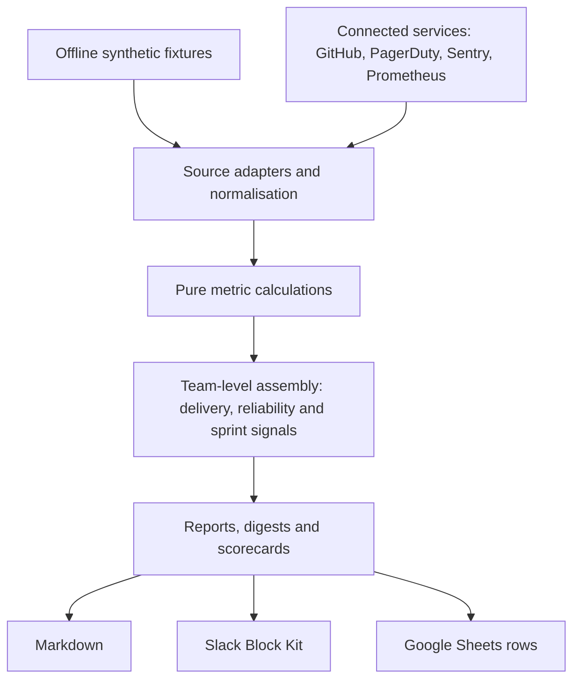

# Baseline

**Engineering health and delivery insight for better team decisions.**

Baseline (`dhk`) brings delivery, reliability and engineering-effectiveness signals into one team-level report, using the tools an engineering organisation already has.

It is designed to help engineering leaders understand how work flows, where friction is building and where improvement may be needed — without turning engineering metrics into individual performance scores.


_Product name: **Baseline** · npm package: `eng-baseline` · CLI: `dhk`_

## Try it

```bash
pnpm install
pnpm dhk demo
```

Run the offline demo before connecting any services. Connect GitHub to generate a report from your own engineering data:

```bash
pnpm dhk connect github
```

The committed sample organisation is fictional and deterministic. It lets you explore the report without credentials or network access.

## Architecture at a glance



The same calculation path processes synthetic demo fixtures and live data from configured integrations. Calculations run locally; connecting services or pushing output explicitly exchanges data with those services. The diagram shows the core flow, not every optional integration or command.

## What it measures

**`dhk report` — the delivery report (DX Core 4):**

| Dimension | Metrics |
| --- | --- |
| **Speed** | Deployment frequency · lead time for changes (DORA 2024 classes) · PR cycle time · time-to-first-review |
| **Effectiveness** | PR/batch size · ticket lead-time percentiles, labelled as system-side proxies |
| **Quality** | Change failure rate (incident-linked when PagerDuty is connected, labelled proxy otherwise) · rework rate · failed-deployment recovery time |
| **Impact** | Feature-vs-maintenance split · tickets/story points · support drag (unplanned load) |

**`dhk digest` — the reliability digest:**

| Section | Metrics |
| --- | --- |
| **Incidents** (PagerDuty) | Count · urgency/severity mix · time-to-detect · recovery time (create→resolve, median/p90) · on-call load by service and out-of-hours share |
| **Errors** (Sentry) | Unresolved issues · new this period · by project/level |
| **SLOs** (Prometheus) | Per-service availability and p95 latency vs targets · attainment roll-up |

Additional commands include `dhk scorecard`, `dhk sprint-health`, `dhk sprint-trend`, `dhk support-drag` and `dhk risky-ticket`. The sprint views include sprint intelligence, scope/churn signals and a concise report to support review conversations.

Output formats: **Markdown** (default), **Slack Block Kit** (`--format slack`) and **Google Sheets rows** (`--format sheets`, `--push` to append to a Sheet).

## Product principles

- **Team-level only.** No per-person metric exists in the data model. The tool is designed to support team improvement, not individual ranking.
- **Local-first.** Computation happens on your machine. Offline mode makes zero network calls; live mode calls only the APIs you connect. No telemetry.
- **Balanced indicators.** Speed is considered alongside effectiveness, quality and impact; no single metric is intended to stand alone.
- **Honest numbers.** Change-failure figures are labelled by their basis (incident-linked or revert proxy). Effectiveness proxies carry a clear note when a DevEx pulse survey is not connected.
- **Deterministic calculations.** Metric calculations and verdict bands are code, not LLM-generated scores.

## The 5-minute path

1. Run `dhk` with no configuration to explore the sample report, reliability digest and three-team scorecard.
2. Run `dhk connect github`; the CLI validates a repo-read token, discovers repositories, saves local configuration and runs the first report.
3. Add other sources as needed. One source is enough to start; each additional connection enriches the report.

Configuration is stored locally at `~/.config/dhk/config.json` with restrictive file permissions.

## Adapts to your stack

The metric definitions are intended to remain consistent; organisation-specific details are configured through adapters and presets.

- **Deploy signal:** live reports use merges to the default branch as a deployment proxy. A merge is not proof that a production deployment occurred; connect a deployment-event source when authoritative deployment data is available.
- **Prometheus metric shape:** Micrometer and client_golang presets, or custom series and labels.
- **Jira taxonomy:** configurable work-categorisation types and labels; sprint-scope fields are optional.
- **Hosts:** self-hosted Sentry, regional PagerDuty and PromQL-compatible endpoints.

## Integrations

| Source | Current implementation status | Needs |
| --- | --- | --- |
| GitHub | Live integration | Token with repository read access |
| PagerDuty | Live integration | Read-only API key |
| Sentry | Live integration | Organisation and auth token |
| Prometheus | Live integration, with per-service SLO configuration | PromQL URL |
| BigQuery deploys | Future optional deployment-event adapter; not currently integrated | GCP project, OAuth token and configured table/query |
| Jira | Computation and sprint model ready; REST fetcher documented but not bundled | Jira credentials |
| Slack / Google Sheets | Optional output integrations | Bot token / OAuth token |

## Why this project exists

In engineering management, the hard part of metrics is rarely producing another dashboard. It is deciding which signals support useful team conversations, identifying misleading proxies, and making improvements without creating individual performance surveillance. Baseline explores that problem as a small, testable, local-first tool rather than a prescriptive team-ranking system.

**What it demonstrates:** metric definition and interpretation, trade-offs between useful proxies and authoritative data, clean separation of adapters and calculations, and delivery safeguards (reproducible fixtures, coverage thresholds, size checks and built-CLI smoke tests). The project is a portfolio implementation and learning exercise, not a claim that this exact tool was deployed at previous employers.

## Engineering approach

Every compute function is pure; fixtures and live fetchers feed the same assembly path. The offline test suite exercises calculations against hand-checked fixtures, without requiring credentials or network access.

The project includes sequential CI gates (typecheck, lint, test and build), a separate end-to-end job that drives the built CLI, coverage and bundle-size ratchets, a pre-push hook, a committed secret-scan test and a standing reviewer.

The standing reviewer uses a **human-owned rubric** covering:

- Claims matching the actual implementation.
- Tests exercising real behaviour.
- Security and input handling.
- No committed secrets.
- Adherence to the requested specification.
- Documentation that accurately describes current behaviour and limitations.

The reviewer is advisory. It can recommend ACCEPT or REJECT, but a human owns the rubric and makes the final decision.

## An iterative approach to engineering and AI

Baseline is part of a broader body of work built up through repeated problem-solving.

I have often started by identifying a specific engineering problem and building a small, focused tool or script to address it — including early single-purpose utilities for sprint reporting, delivery insight and engineering workflows. Those experiments were used to test ideas, learn what was useful and shape the next iteration.

The current project brings those lessons together in a more comprehensive, maintainable application. AI-assisted development with Claude, alongside my own starter templates, prompts and engineering harnesses, has helped accelerate implementation, explore alternatives and expand testing.

The engineering direction remains human-led: identifying the problem, choosing the approach, shaping the architecture, reviewing generated work, challenging assumptions and deciding what is ready to keep. AI is used as an engineering multiplier, not as a substitute for ownership or judgement.

This repository is an accumulation of that work and learning, rather than a claim that the current implementation was deployed unchanged in previous companies.

## Development

```bash
pnpm typecheck && pnpm lint && pnpm test
pnpm build && pnpm size && pnpm e2e
pnpm review
```

The demo uses committed synthetic data in `fixtures/sample-org/`, generated deterministically by `scripts/generate-sample-org.mjs`.

## Status and roadmap

- ✅ Demo-first onboarding and GitHub → Core-4 report.
- ✅ Reliability digest, scorecard and sprint model.
- ✅ Markdown, Slack and Sheets output paths.
- ◻ Consider an optional BigQuery deployment-event adapter when a real source and validation environment are available.
- ◻ Bundle the Jira live fetcher into `--live`.
- ◻ Add a DevEx pulse survey to complete the Effectiveness/DXI measure.
- ◻ Explore an AI-readiness view based on DORA capability signals.
- ◻ Add period/trend comparison and export/API support for internal developer portals.

## Licence

Licensed under the MIT License. The package remains marked private in npm metadata.
