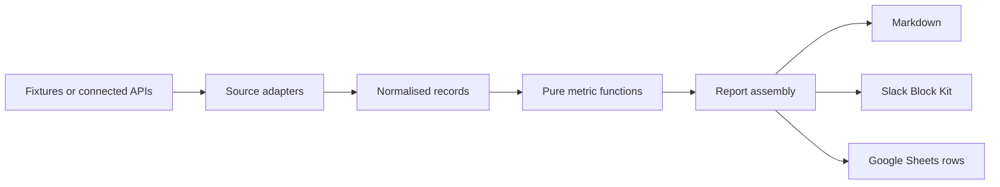

# Baseline architecture

Baseline has one calculation path for offline fixtures and connected sources. Adapters obtain source records; pure functions calculate metrics; report assembly combines the available results; renderers produce Markdown, Slack blocks or Sheets rows.

The shared record types are in `src/types.ts`. Source calculations and fetchers live under `src/sources/`; assembly is in `src/report/assemble.ts`; output renderers live under `src/report/`. CLI commands are defined in `src/cli.ts`.

Offline mode uses committed fixtures and makes no network calls. Live fetchers use injected `fetch` functions in tests, so the automated suite does not contact external services. Optional output integrations only send data when the corresponding command is configured to do so.

## Architecture decisions

- **One calculation path for fixtures and live records.** Source adapters normalise inputs before calculation, so the offline demo exercises the same metric functions as live reports. Source completeness still depends on the adapter; passing fixture tests does not establish production API compatibility.
- **Local computation with explicit service access.** Calculations need no hosted backend. Live reads and optional output pushes exchange data with configured services, so local-first does not mean that all commands are network-free.
- **Team-level shared model.** `src/types.ts` defines aggregate report records without individual performance metrics. This keeps individual ranking outside the report contract; source records may still contain identifiers needed for filtering.
- **Zero runtime dependencies.** Live paths use native `fetch` and plain REST. This keeps installation and the runtime surface small, while leaving pagination, retries and response normalisation to the adapters and their tests.

## Deployment signal

The default GitHub path treats merged PRs as a deployment proxy. A merge does not establish that production deployment occurred. The BigQuery adapter exists and has mocked-fetch tests, but it is not wired into a live CLI command in this version. The README should continue to describe it as unintegrated until that path exists.

## Data boundary

Metric computation runs locally. Live source connections send requests to the services the user configures. Baseline has no telemetry path. The team-level data model and secret-scan test are part of the product boundary; neither is a substitute for reviewing what a configured source returns.

## Code map

- `src/sources/`: source-specific parsing, fetching and pure calculations.
- `src/reads/`: higher-level interpretations such as sprint health and support drag.
- `src/report/`: assembly and output formats.
- `fixtures/` and `tests/`: deterministic examples and expected behaviour.
- `scripts/e2e-smoke.sh`: exercises the built CLI.
